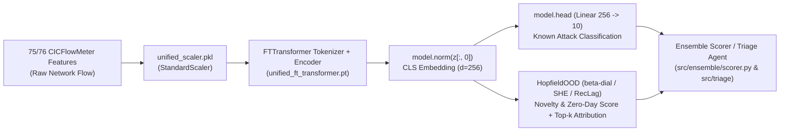

# Runbook: Integrating `scikit-hopfield` (`HopfieldOOD`) with `cnds` & `ML-IDS`

This guide provides the step-by-step execution plan to connect **`scikit-hopfield`** (`HopfieldOOD`) as the **post-hoc novelty detection channel** over the frozen `FTTransformer` (`models/unified/unified_ft_transformer.pt`, $d_{\text{token}}=256$, 10 classes) in **`cnds`** and **`ML-IDS`**.

---

## 1. Architecture & Data Flow



### Key Design Invariant (No Retraining Required for Phase 1)
In `~/repos/cnds/src/models/ft_transformer.py`, `FTTransformer.forward` computes:
```python
tokens = x.unsqueeze(-1) * self.tokenizer_w + self.tokenizer_b
cls = self.cls.expand(x.size(0), -1, -1)
z = torch.cat([cls, tokens], dim=1)
z = self.encoder(z)
return self.head(self.norm(z[:, 0]))
```
The penultimate layer representation $\boldsymbol{\xi} \in \mathbb{R}^{256}$ is `self.norm(z[:, 0])`. Adding an `encode_cls(x)` method (or `forward_with_embedding(x)`) does **not** alter `state_dict` keys or weights, preserving 100% compatibility with `models/unified/unified_ft_transformer.pt`.

---

## 2. Step-by-Step Integration in `cnds` & `ML-IDS`

### Step 1: Install `scikit-hopfield` into the `cnds` and `ML-IDS` environments
```bash
# In ~/repos/cnds
uv pip install -e ~/repos/scikit-hopfield

# In ~/repos/ML-IDS
uv pip install -e ~/repos/scikit-hopfield
```

### Step 2: Expose `encode_cls` in `src/models/ft_transformer.py`
Add `encode_cls` and `forward_with_cls` to `FTTransformer` in `~/repos/cnds/src/models/ft_transformer.py`:

```python
    def encode_cls(self, x: torch.Tensor) -> torch.Tensor:
        """Extracts the 256-d LayerNormed CLS token prior to the classification head."""
        tokens = x.unsqueeze(-1) * self.tokenizer_w + self.tokenizer_b
        cls = self.cls.expand(x.size(0), -1, -1)
        z = torch.cat([cls, tokens], dim=1)
        z = self.encoder(z)
        return self.norm(z[:, 0])

    def forward_with_cls(self, x: torch.Tensor) -> tuple[torch.Tensor, torch.Tensor]:
        """Returns (logits, cls_embedding) in a single forward pass."""
        cls_emb = self.encode_cls(x)
        return self.head(cls_emb), cls_emb
```

### Step 3: Build & Fit the Hopfield Memory Bank (`models/unified/hopfield_ood.joblib`)
Create `scripts/fit_hopfield_ood.py` in `ML-IDS` (or `cnds`) to extract the training `CLS` embeddings once and evaluate the three memory regimes (`she`, `kmeans`, `reclag`):

```python
#!/usr/bin/env python3
"""Extracts CLS embeddings from unified_ft_transformer.pt and fits HopfieldOOD."""
import joblib
import numpy as np
import torch
from scikit_hopfield import HopfieldOOD
from src.models.ft_transformer import build_from_checkpoint, load_checkpoint

bundle = load_checkpoint("models/unified/unified_ft_transformer.pt", map_location="cuda")
model = build_from_checkpoint(bundle).cuda().eval()
scaler = joblib.load("models/unified/unified_scaler.pkl")

# X_train_raw, y_train: 70% training split used for unified_ft_transformer.pt
# Extract CLS embeddings in batches
@torch.no_grad()
def extract_cls(X_scaled: np.ndarray, batch_size: int = 4096) -> np.ndarray:
    out = []
    for i in range(0, len(X_scaled), batch_size):
        batch = torch.as_tensor(X_scaled[i : i + batch_size], dtype=torch.float32, device="cuda")
        with torch.amp.autocast("cuda", dtype=torch.bfloat16):
            cls_emb = model.encode_cls(batch)
        out.append(cls_emb.float().cpu().numpy())
    return np.vstack(out)

# Fit the three memory strategies from the Obsidian research note:
# (a) SHE: 10 class prototypes (instant, 10 x 256)
# (b) K-Means: 256 prototypes (fast streaming inference)
# (c) RecLag: Rectified Lagrangian with origin attractor (tau_rect=0.5)
det_she = HopfieldOOD(beta=8.0, mode="she", contamination=0.01).fit(cls_train, y_train)
det_reclag = HopfieldOOD(beta=16.0, mode="reclag", tau_rect=0.55, contamination=0.01).fit(cls_train)

joblib.dump({"she": det_she, "reclag": det_reclag}, "models/unified/unified_hopfield_ood.joblib")
```

### Step 4: Wire `HopfieldOOD` into `src/engines/ft_transformer_engine.py` and `src/triage/`
In `~/repos/cnds/src/engines/ft_transformer_engine.py`, compute the Hopfield novelty score alongside `1 - P(Benign)` and pass `det.explain(cls_emb, top_k=3)` into the CORTEX-style triage annotation (`src/triage/`):

```python
# Inside FTTransformerEngine.predict / anomaly_score:
logits, cls_emb = self._model.forward_with_cls(tensor_x)
cls_np = cls_emb.float().cpu().numpy()

hopfield_score = float(self._hopfield_ood.decision_function(cls_np)[0])
hopfield_explanation = self._hopfield_ood.explain(cls_np, top_k=3)
```

---

## 3. Experimental Protocol for Tomorrow (β-Sweep + Leave-One-Attack-Class-Out)

Following the rules in `Claude y agentic AI en mis proyectos.md` (anti-MLR-Bench fabrication):

1. **Afternoon Fast Signal (No Retraining):**
   - Extract `cls_train`, `cls_val`, `cls_test` from the frozen `unified_ft_transformer.pt`.
   - Sweep $\beta \in \{1, 2, 4, 8, 16, 32, 64\}$ across modes `she`, `kmeans` ($K=256$), `full`, and `reclag` ($\tau_{\text{rect}} \in \{0.3, 0.5, 0.7\}$).
   - Compare **AUROC**, **PR-AUC**, and **FPR95** directly against:
     - `MSP` ($1 - \max_c P(y=c|\mathbf{x})$)
     - `Energy of Logits` (Liu et al., NeurIPS 2020)
     - `KNN` ($k=1$ and $k=50$, Sun et al., ICML 2022)
     - Existing `IsolationForest` and `LSTM-AE` z-scores.
   - Log every trial to **MLflow (`http://192.168.1.147:5000`)** and require a valid `run_id` in `results.json` via the BADSFA `Stop` hook.
2. **Leave-One-Attack-Class-Out (LOACO) Validation:**
   - Hold out each of the 9 attack classes in turn, fit `HopfieldOOD` only on `Benign` + the remaining 8 attack classes, and measure detection recall & FPR95 on the held-out unseen attack family.
3. **Ensemble Diversity Check:**
   - Compute Spearman rank correlation between `HopfieldOOD` scores and `IF` / `LSTM-AE` scores on `cls_test`. If rank correlation $< 0.75$ and LOACO PR-AUC improves via rank-fusion (Niimi 2026), promote `HopfieldOOD` into `src/ensemble/scorer.py`.
