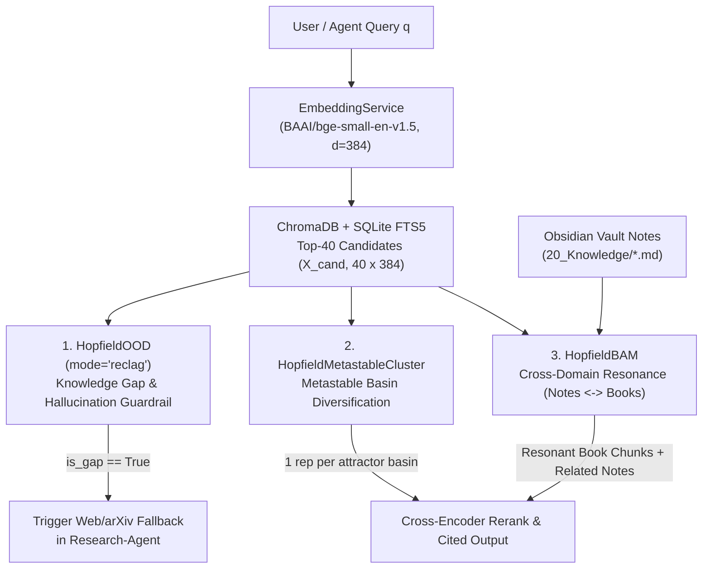

# Runbook: Integrating `scikit-hopfield` with the RAG Ecosystem (`pdf-books-mcp`, Obsidian Vault & `Research-Agent`)

This guide details how to connect **`scikit-hopfield`** (`HopfieldOOD`, `HopfieldMetastableCluster`, and `HopfieldBAM`) into:
1. **`pdf-books-mcp`** (`C:\Users\robca\.gemini\antigravity\scratch\pdf-books-mcp\src\pdf_books_mcp\retrieval.py` — 474 indexed books, 238,557 ChromaDB chunks, `BAAI/bge-small-en-v1.5` $d=384$).
2. **Obsidian Vault** (`C:\Users\robca\Nextcloud2\Notes\Vault\20_Knowledge\`, fulfilling `ROADMAP_semantic_search.md`).
3. **`Research-Agent`** (`~/repos/Research-Agent`).

---

## 1. Architecture of the Hopfield-Enhanced RAG Pipeline



---

## 2. Three Concrete Upgrades to `pdf-books-mcp` & Obsidian

### Upgrade A: Knowledge Gap Guardrail (`HopfieldOOD` in `retrieval.py`)
In standard RAG, ChromaDB always returns `top_k` chunks even when the query topic is absent from the 474 books, causing downstream agents to hallucinate connections.

By requesting `"embeddings"` in `semantic()` inside `src/pdf_books_mcp/retrieval.py` (line 104):
```python
res = store.collection.query(
    query_embeddings=[query_vec],
    n_results=n,
    where=where,
    include=["documents", "metadatas", "distances", "embeddings"],
)
```
we evaluate `HopfieldOOD(beta=16.0, mode="reclag", tau_rect=0.58)` directly on the $40 \times 384$ candidate embeddings:

```python
import numpy as np
from scikit_hopfield import HopfieldOOD

def check_library_coverage(query_vec: list[float], cand_embeddings: list[list[float]]) -> dict:
    X_cand = np.asarray(cand_embeddings, dtype=float)
    q = np.asarray(query_vec, dtype=float)[None, :]
    det = HopfieldOOD(beta=16.0, mode="reclag", tau_rect=0.58).fit(X_cand)
    score = float(det.decision_function(q)[0])
    # In RecLag mode, score == 0.0 means all candidate similarities fell below tau_rect
    return {
        "hopfield_energy": score,
        "knowledge_gap": score >= -1e-6,
    }
```
If `knowledge_gap == True`, `search_books` prepends `> [!WARNING] Knowledge Gap Detected: Query falls outside high-density associative basins in the local book library` so `Research-Agent` immediately routes the query to arXiv/web search.

---

### Upgrade B: Metastable Basin Diversification (`HopfieldMetastableCluster`)
In `src/pdf_books_mcp/retrieval.py` (line 183), `diversify()` currently filters results using a 400-character string prefix (`r["text"][:400]`) and `per_book_cap`. When 15 chunks from 5 books repeat the exact same introductory definition, they still fill the `top_k` slots.

Using `HopfieldMetastableCluster(beta=10.0, merge_tol=0.08)` on the candidate embeddings:
1. Candidate chunks that belong to the same semantic sub-topic coalesce into the **same metastable attractor**.
2. Selecting the highest-RRF/rerank chunk from **each distinct metastable cluster** guarantees that `top_k=5` covers 5 genuinely distinct technical perspectives (and fulfills the *"automatic synthesis of related notes/chunks"* goal in `ROADMAP_semantic_search.md`).

```python
from scikit_hopfield import HopfieldMetastableCluster

def diversify_by_metastable_basins(cands: list[dict], cand_embeddings: np.ndarray, top_k: int = 5) -> list[dict]:
    clusterer = HopfieldMetastableCluster(beta=10.0, merge_tol=0.08).fit(cand_embeddings)
    selected, seen_basins = [], set()
    # First pass: take the best-ranked chunk from each distinct metastable attractor
    for idx, cand in enumerate(cands):
        basin = int(clusterer.labels_[idx])
        if basin not in seen_basins:
            seen_basins.add(basin)
            cand["metastable_basin"] = basin
            selected.append(cand)
            if len(selected) >= top_k:
                return selected
    # Second pass if fewer basins than top_k
    for cand in cands:
        if cand not in selected:
            selected.append(cand)
            if len(selected) >= top_k:
                break
    return selected
```

---

### Upgrade C: Cross-Domain Resonance `Obsidian Vault` $\leftrightarrow$ `Technical Books` (`HopfieldBAM`)
In your Obsidian Vault (`C:\Users\robca\Nextcloud2\Notes\Vault\20_Knowledge\`), notes already contain explicit book citations (`## Fuentes -> Libros`).

We can construct an aligned associative index (`scripts/build_vault_bam.py`) where:
- **Domain A (`X_notes`):** `BAAI/bge-small-en-v1.5` embeddings of your Obsidian notes in `20_Knowledge/*.md` and `10_Projects/Blog/*.md`.
- **Domain B (`Y_books`):** Centroid embeddings of the cited book chapters in ChromaDB corresponding to each note.

```python
from scikit_hopfield import HopfieldBAM

# Fit once when indexing the Vault (< 50 ms for ~100 notes in d=384)
bam = HopfieldBAM(beta=15.0, gap_quantile=0.98).fit(X_vault_notes, Y_cited_book_centroids)

# Given a new draft note or question in Obsidian:
res = bam.resonate(new_note_embedding, top_k=3)
gap = bam.detect_knowledge_gap(new_note_embedding)
```
- **`bam.resonate()`** reverberates between your personal notes and the book library until reaching a stationary fixed point, returning the top-3 book chapters that resonate with your note architecture.
- **`bam.detect_knowledge_gap()`** tells you whether a new note in `00_Inbox/` is already covered by your existing `20_Knowledge/` + books or represents a brand-new research topic.

---

## 3. Installation Command for Tomorrow

```powershell
# Install scikit-hopfield into the pdf-books-mcp virtual environment on Windows:
C:\Users\robca\.gemini\antigravity\scratch\pdf-books-mcp\.venv\Scripts\pip.exe install -e C:\Users\robca\.gemini\antigravity\scratch\scikit-hopfield
```
