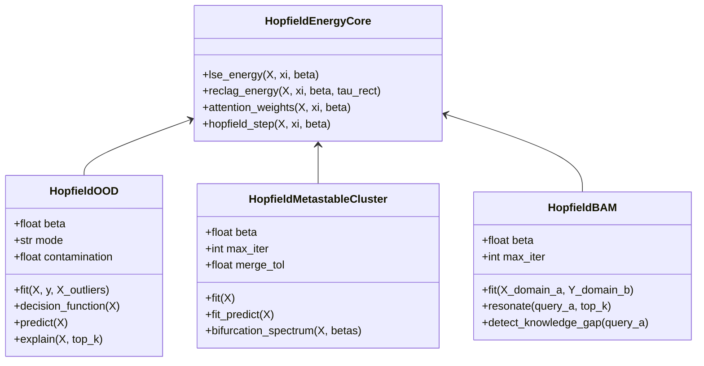

# ADR-0001: Unified Modern Hopfield Energy Estimators (`scikit-hopfield`)

- **Date:** 2026-10-22
- **Status:** Accepted
- **Persona:** `@Architect`

## Context

Existing libraries leave a critical gap between Modern Hopfield Network theory and practical `scikit-learn` / `PyOD` workflows:
1. `pytorch-ood` only implements the degenerate `SHE` limit (1 mean prototype per class, $\beta \to 0$) coupled to vision `DataLoader` objects.
2. `PyOD` has zero Modern Hopfield estimators (`OutlierMixin`), lacking the continuous $\beta$-dial between 1-NN ($\beta \to \infty$) and centroid (`SHE`), **Hopfield Boosting** with auxiliary outliers, and **Rectified Lagrangian (`RecLag`, AAAI 2025)**.
3. Knowledge-graph / Obsidian tools (`NeuroStack`) lack a `scikit-learn`-compatible **Metastable Bifurcation Clusterer (`ClusterMixin`)** and **Continuous Bidirectional Associative Memory (`HopfieldBAM`)** capable of resonating across two distinct embedding spaces (e.g., Vault Notes $\leftrightarrow$ Technical Books) while flagging Out-of-Distribution knowledge gaps.

## Decision

Implement a zero-bloat, NumPy-first (with optional PyTorch acceleration) `scikit-learn`-compatible package `scikit_hopfield` exposing three estimators governed by a shared, numerically stable energy core:

## Consequences

- **Positive:** One mathematical engine powers both the IDS Novelty Channel (`cnds` / `ML-IDS`) and the Associative Knowledge Vault (`Obsidian` $\leftrightarrow$ `pdf-books-mcp`), verified by deterministic BADSFA hooks.
- **Negative / Constraints:** High $\beta$ values ($\beta > 100$) can cause naive exponential overflow; `HopfieldEnergyCore` must strictly use max-shifted `logsumexp`.
